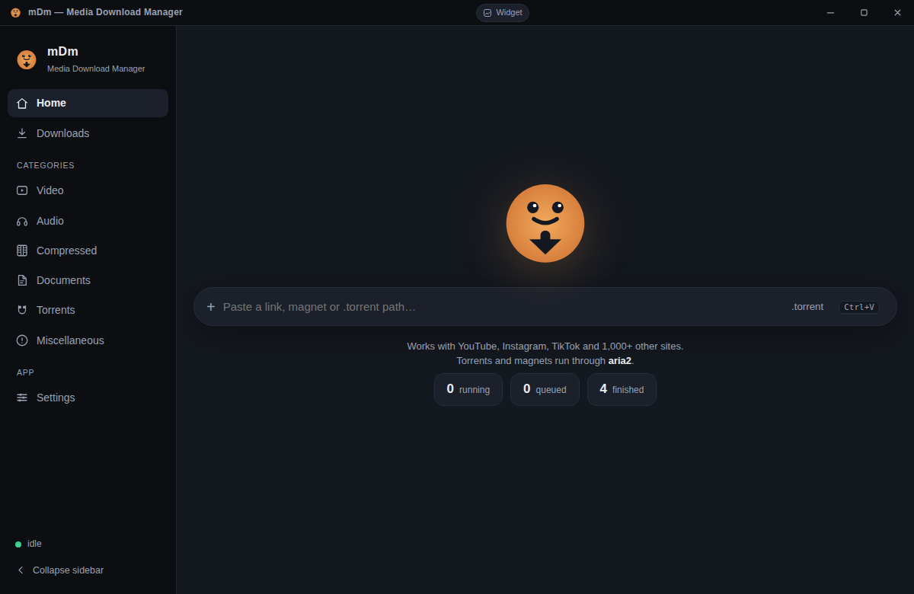
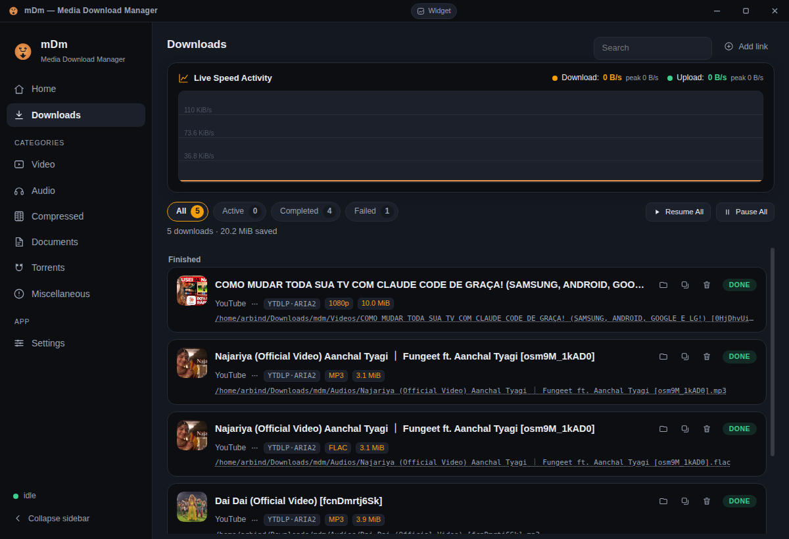
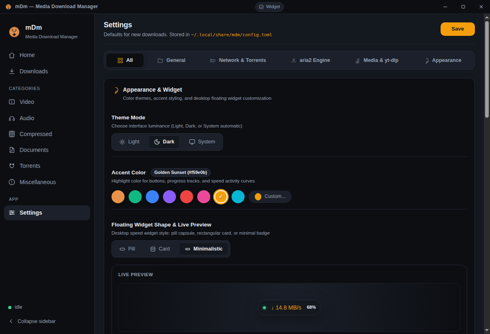

# mDm — Media Download Manager

<p align="center">
  
</p>

<p align="center">
  <b>A fast, unified download manager for Linux & Windows.</b><br>
  Built with <b>Rust</b>, <b>Tauri 2</b>, <b>yt-dlp</b> (1,000+ video sites), and <b>aria2</b> (multi-connection HTTP, BitTorrent & Magnet).
</p>

<p align="center">
  
  
  
  
  
</p>

---

## Screenshots

<p align="center">
  <b>Home & Instant Link Addition</b><br>
  
</p>

<p align="center">
  <b>Active Downloads & Real-Time Speed Activity Graph</b><br>
  
</p>

<p align="center">
  <b>Settings & Floating Widget Customization</b><br>
  
</p>

<p align="center">
  <b>Desktop Floating Speed Widget (Draggable, Frameless Pill)</b><br>
  
</p>

---

## Key Features

- **Unified Dual-Engine Download Core**:
  - **yt-dlp**: Download video & audio from over 1,000 websites (YouTube, Instagram, TikTok, Twitter/X, Twitch, Soundcloud, Vimeo, etc.).
  - **aria2**: High-throughput multi-connection engine for direct files (HTTP/HTTPS/FTP), BitTorrent (`.torrent`), and Magnet URIs.
  - **Smart Acceleration & Fallback**: Offload stream chunks from yt-dlp to aria2 for up to 16 parallel connections, with automatic fallback to native yt-dlp downloader on network retry.

- **Desktop Floating Speed Widgets**:
  - Frameless, always-on-top, draggable mini-widgets displaying live download/upload speeds and progress.
  - Three switchable styles:
    - **Pill**: Ultra-sleek capsule (`[ ● ↓ 0 B/s ↑ 0 B/s | ———— 0% ✕ ]`).
    - **Card**: Compact dashboard card with title, speed graph, and active count.
    - **Minimalistic**: Clean, distraction-free speed badge.
  - Double-click to restore main window; zero compositor shadow/ghosting artifacts.

- **Interactive Playlist Inspector**:
  - Automatically recognizes media playlists when pasting a URL.
  - Fetches and displays all items with titles, authors, durations, and thumbnails.
  - Flexible controls: select all, custom range checkboxes, title search filter, and format selection (Video or Audio).

- **Rich Audio Extraction & Album Artwork**:
  - Extracts audio to high-bitrate **MP3**, **FLAC**, **M4A**, **Opus**, or **WAV**.
  - Embeds universal JPEG front cover artwork and ID3v2 tags (`Title`, `Artist`, `Album`, `Track Number`) compatible with all media players and file managers (GNOME Files, Windows Explorer, macOS Finder).

- **Smart Category Sorting**:
  - Automatically routes completed files into organized subfolders:
    - `Compress/` (`.zip`, `.rar`, `.7z`, `.tar`, `.gz`, etc.)
    - `Videos/` (`.mp4`, `.mkv`, `.webm`, `.avi`, etc.)
    - `Audios/` (`.mp3`, `.flac`, `.m4a`, `.opus`, etc.)
    - `Document/` (`.pdf`, `.doc`, `.docx`, `.xls`, `.md`, `.html`, etc.)
    - `Torrents/` (`.torrent`)
    - `Miscellaneous/` (other file formats)

- **Self-Contained & Zero Config Setup**:
  - `mdm setup` (and daemon auto-init) downloads required dependencies (`yt-dlp`, `aria2c`, `ffmpeg`, `ffprobe`) into `~/.local/share/mdm/bin` with SHA-256 validation. No root privileges required.

- **Cross-Platform Desktop & Web**:
  - Native **Tauri 2** desktop application with system tray support.
  - Embedded web UI accessible on `http://127.0.0.1:5757` from any browser or device.
  - Companion **Chrome / Chromium Browser Extension** for 1-click browser downloads.

- **REST API & Live WebSockets**:
  - Full localhost HTTP REST API and WebSocket events stream (`/api/events`) for automation, scripting, and remote control.

---

## Installation & Downloads

### Linux (.deb)
Download the latest `.deb` package from the [Releases](https://github.com/habitual69/mdm/releases) page:
```bash
sudo dpkg -i "mDm Media Download Manager_0.1.0-alpha.1_amd64.deb"
```

Or run the portable binary:
```bash
cp mdm-app ~/.local/bin/
mdm-app
```

### Windows (Portable ZIP)
1. Download `mDm_0.1.0-alpha.1_windows_x64.zip` from [Releases](https://github.com/habitual69/mdm/releases).
2. Extract the archive.
3. Launch `mdm-app.exe` (requires Microsoft Edge WebView2 runtime, pre-installed on Windows 10/11).

---

## Quick Start (CLI)

```bash
# Setup dependencies automatically (yt-dlp, aria2c, ffmpeg)
mdm setup

# Add a video or audio stream
mdm add "https://www.youtube.com/watch?v=dQw4w9WgXcQ"

# Add a BitTorrent file or Magnet link
mdm add "magnet:?xt=urn:btih:..."

# Check live queue status
mdm ls --watch

# Open the Web Dashboard in browser
xdg-open http://127.0.0.1:5757
```

---

## Project Structure

```
mdm/
├── crates/
│   ├── mdm-core/          # Database queue (SQLite), job models, config manager
│   ├── mdm-engine-ytdlp/  # yt-dlp driver, progress parsing, rich metadata
│   ├── mdm-engine-aria2/  # aria2 JSON-RPC daemon manager & BitTorrent client
│   ├── mdm-bins/          # Cross-platform dependency installer (SHA-256 verified)
│   ├── mdm-server/        # Axum REST & WebSocket server + embedded Web UI
│   └── mdm-cli/           # Command-line interface (`mdm add`, `mdm ls`, etc.)
├── mdm-app/               # Tauri 2 native desktop application shell
├── extension/             # Chrome / Chromium companion browser extension
└── docs/                  # Screenshots & architecture documentation
```

---

## Configuration

Settings are stored in `~/.local/share/mdm/config.toml` (Linux) or `%APPDATA%\mdm\config.toml` (Windows) and can be configured through the UI or REST API:

```toml
output_dir = "~/Downloads/mdm"
max_concurrent = 4
max_retries = 3
speed_limit = ""                    # Overall bandwidth cap (e.g., "5M", "500K")
proxy = ""                          # HTTP / SOCKS5 proxy

# Appearance & Widgets
theme = "dark"                      # "dark" | "light" | "system"
accent_color = "#e8934a"            # Hex accent color
widget_shape = "pill"               # "pill" | "card" | "minimalistic"

# aria2 Multi-Connection
aria2_connections = 8
aria2_splits = 8
aria2_offload = true
aria2_fallback = true

# Media & yt-dlp
ytdlp_audio_format = "mp3"          # "mp3" | "flac" | "m4a" | "opus" | "wav"
embed_metadata = true
embed_thumbnail = true
```

---

## REST API Overview

The embedded server exposes a full REST API on `http://127.0.0.1:5757`:

| Method | Endpoint | Description |
| --- | --- | --- |
| `GET` | `/api/health` | Service health check |
| `GET` | `/api/jobs` | List all download jobs |
| `POST` | `/api/jobs` | Submit a new download job |
| `POST` | `/api/jobs/batch` | Batch submit multiple items (e.g. from playlist) |
| `POST` | `/api/jobs/{id}/pause` | Pause an active download |
| `POST` | `/api/jobs/{id}/resume` | Resume a paused download |
| `DELETE` | `/api/jobs/{id}` | Cancel and remove a job |
| `POST` | `/api/playlist-info` | Extract videos from a playlist URL |
| `GET` / `PUT` | `/api/config` | Read or update configuration options |
| `GET` | `/api/events` | Real-time WebSocket event stream |
| `POST` | `/api/window/*` | Desktop window actions (`minimize`, `toggle-floating`, etc.) |

---

## Building from Source

### Prerequisites
- [Rust toolchain](https://rustup.rs/) (1.80+)
- Node.js (v18+) for Tauri CLI
- Linux packages: `libgtk-3-dev`, `libwebkit2gtk-4.1-dev`, `libayatana-appindicator3-dev`

```bash
# Clone the repository
git clone https://github.com/habitual69/mdm.git
cd mdm

# Run tests
cargo test --workspace

# Run the desktop application in development mode
cd mdm-app
npx @tauri-apps/cli dev

# Build production Linux release (.deb)
npx @tauri-apps/cli build --bundles deb
```

### Windows Cross-Compilation from Linux
```bash
# Install target
rustup target add x86_64-pc-windows-gnu

# Build release Windows binaries (mdm-app.exe & mdm.exe)
cargo build --release --target x86_64-pc-windows-gnu --bin mdm --bin mdm-app
```

---

## License

This project is licensed under the [MIT License](LICENSE).
